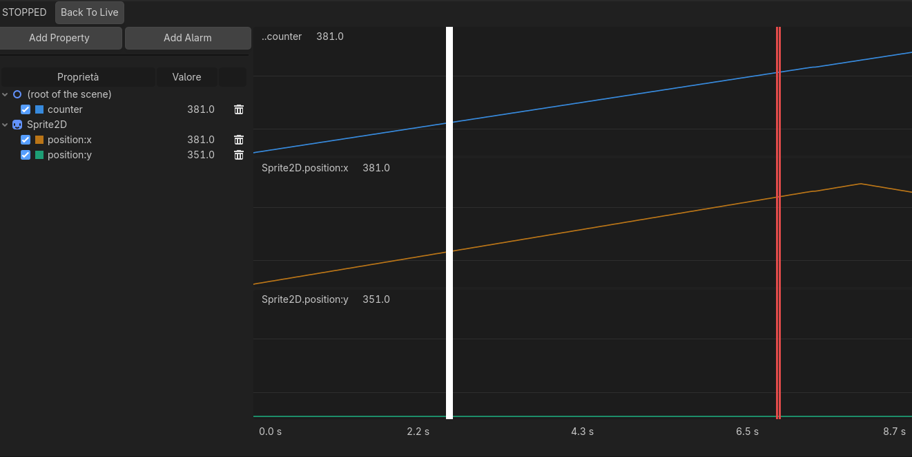
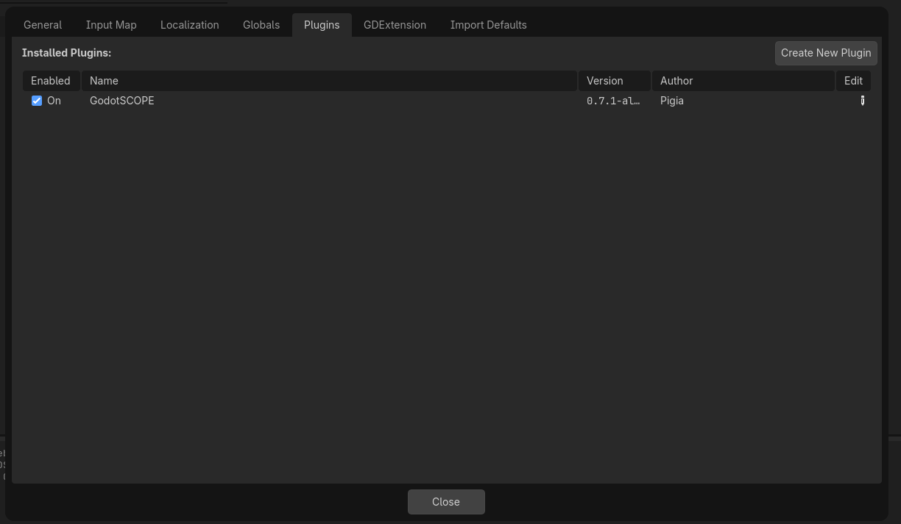
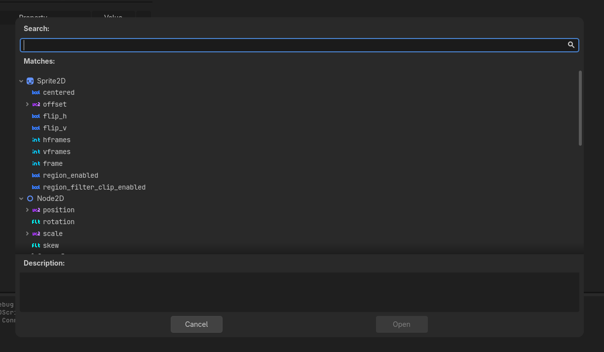
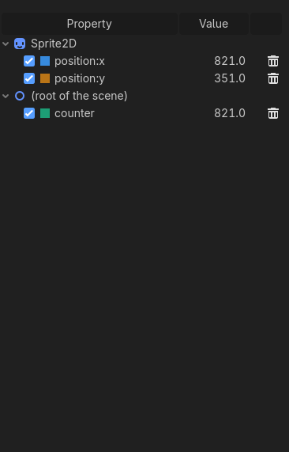
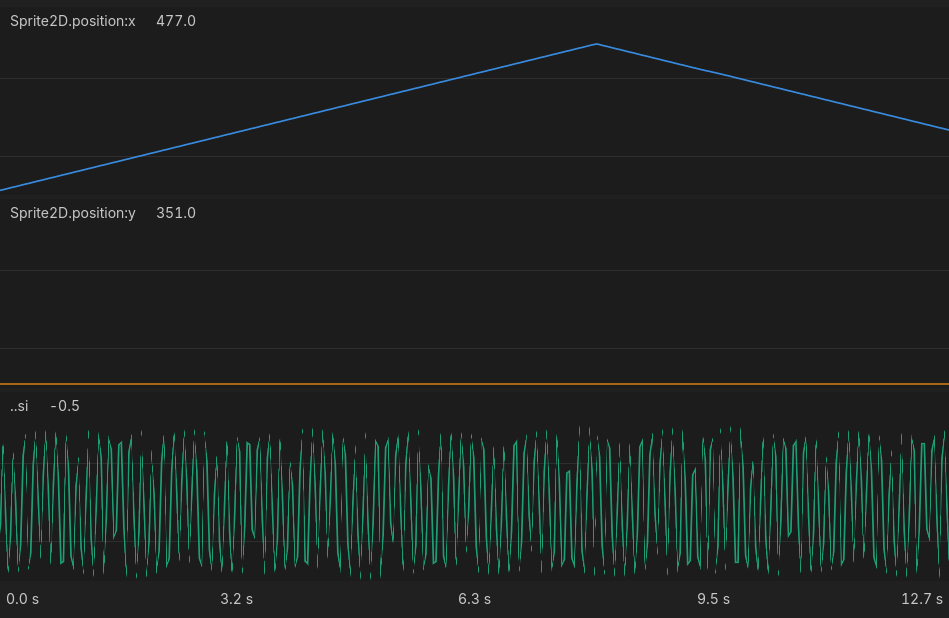
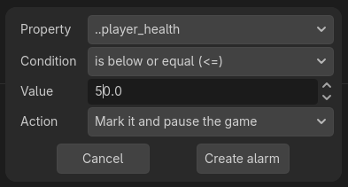

# What is GodotSCOPE?

GodotSCOPE is a Godot 4 plugin to monitor the properties of your nodes runtime without writing a single line of code. You pick any property of any node and GodotSCOPE records its value while your game runs, drawing one live graph.

## Requirements

| | |
|---|---|
| **Godot** | 4.6 or newer. Tested with 4.6 and 4.7 |
| **Language** | GDScript only |
| **Platforms** | Anywhere the Godot editor runs |

## Installation

### From Github Releases

1. Download the lates [release](https://github.com/dePigia/GodotSCOPE/releases/latest)
2. Extract the zip and move the `addons/GodotSCOPE` folder into your project's `addons/` folder

## Enabling the plugin

Open **Project -> Project Settings -> Plugins** and tick **GodotScope**. A new **GodotSCOPE** tab appears next to *2D*, *3D*, *Script*, *Asset Store*.

Enabling the plugin also registers a small autoload named `GodotSCOPE`, which is the part that runs inside your game. Disabling the plugin removes it.

For more help installing plugins, see [Godot's official guide](https://docs.godotengine.org/en/stable/tutorials/plugins/editor/installing_plugins.html).

## Using GodotSCOPE

### Adding properties

Click **Add Property**. First choose a node from the scene open in the editor, then choose one of its properties. The list only shows values that can be drawn: integers, floats, booleans, vectors and colors.

- Vectors and colors are split into components automatically (`position:x`, `position:y`, `modulate:a`, etc), each with its own graph.
- Picking the same property twice does nothing.
- Variables of your own scripts appear in the list only if they are marked `@export`. *(if they aren't displayed, try reloading the plugin)*.

### The property tree

Each monitored property is a row under its node:

- the **checkbox** shows or hides its graph (it is still being recorded, so you can bring it back with its full history)
- the **colored square** matches the color of its line in the graph
- the **Value** column shows the current value, or the value under the cursor when you are looking at the past
- the **trash button** stops monitoring it and removes its alarms

Hover a row to see the full node path and property name.

### The Graphs

Every property gets its own lane, with its name and value at the top. Each lane scales itself to the minimum and maximum of what has been recorded. The time axis tells you how long it is.
 
If a value is missing for a while (the node was removed, or the property is not a number), the line simply breaks instead of inventing data.

Click or drag anywhere on the graphs to place the cursor. The values under it appear in every lane and in the tree, and the status label switches to `HISTORY`.

Click **Back To Live** to follow the newest data again. When the game stops, the recording stays available until the next time you press Play.

### Alarms

Click **Add Alarm** and fill in four fields:

| Field | Meaning |
|---|---|
| **Property** | Which monitored property to watch (the last one you added is preselected) |
| **Condition** | `is below (<)`, `is below or equal (<=)`, `is equal (==)`, `is above or equal (>=)`, `is above (>)` |
| **Value** | The limit, as a number *(for boolean numers use 1 for `true` and 0 for `false`)*|
| **Action** | `Only mark it on the graph`, or `Mark it and pause the game` |

An alarm triggers **once, at the moment the condition becomes true**. It arms again as soon as the condition becomes false.
 
Each trigger leaves a **red marker** on the graphs. Hover it to read the frame number.

With the pause action, the game freezes at the exact sample that triggered the alarm. The status label shows `PAUSED` and the cursor jumps to that sample, so you can read every value at that instant.
 
When you are done, press **Continue**. The game resumes, the label goes back to `LIVE`.

## Contributing

Bug reports, ideas and pull requests are welcome. Please open an [issue](https://github.com/dePigia/GodotSCOPE/issues). Code follows the [GDScript style guide](https://docs.godotengine.org/en/stable/tutorials/scripting/gdscript/gdscript_styleguide.html), with typed variables (so please use that).

## Credits

The plugin is made by Pigia.

Made with [Godot Engine](https://godotengine.org).

Some parts of this plugin were made by the assistant of an AI, and then reviewed and written by me.

[MIT License](LICENSE)